# 致命的 160 公里：烏克蘭戰場上的星鏈攻防、偽造座標與一場被物理定律收網的漏洞

> 本導讀的分析與撰稿由 AI 模型完成，不是人類分析，也沒有經過人工逐句校稿。文中事實經 Claude Opus 5.5、Codex gpt-6.1-sol 與 agy Gemini 4 Argon High 三方旗艦模型獨立查核，以文末具名公報與原始文檔為準；推論與單方說法皆已標示。

**本文怎麼讀**：標示「**推論分析**」的，是依物理原理與公開資訊做的合理推測，沒有官方文件證實；標示「**單方主張**」的，是俄方或單一當事人的說法，只能當作「特定陣營的論述」。沒有標示的，才是有第一手官方公報、當事人代碼文檔或具名調查支撐的事實。

---

## 引言：戰場上的「致命 160 公里」

想像一架防空攔截無人機正全速追擊俄軍噴射動力版 Shahed（見證者）自殺無人機。敵機時速高達數百公里，烏軍攔截機必須更快，時速常飆升至 180 到 300 公里以上。就在鎖定敵機的關鍵時刻，操作端螢幕突然凍結、遙控鏈路全斷。無人機不是被擊落，也不是遭遇前線電戰壓制，而是衛星網路的通訊被後端系統「切斷」了。

這正是烏克蘭總統國防科技與電戰顧問 Serhii Beskrestnov（呼號 "Serhii Flash"）在 **2026 年 10 月 14 日** 公開踢爆的戰場危機：SpaceX 無預警對烏軍運作中的衛星終端實施約 100 mph（約 160 km/h）的硬性移動速限，超速即斷線，連追擊 Shahed 的防空無人機與作戰直升機都遭遇毀滅性盲飛（[Serhii Flash Telegram](https://t.me/serhii_flash)）。

**這 160 公里，是一條由商業服務條款畫出來的數位紅線，卻切在攸關國家防空獵殺的生死關頭上。**

從 2026 年 10 月 14 日爆發斷訊，到 10 月 24 日烏克蘭國防部與總統澤倫斯基宣布恢復 400+ km/h 高速運作，這場震撼美烏兩國的**「十日斷訊危機」**，揭開了一場圍繞低軌衛星、前線逆向工程與跨國地緣政治的高維博弈。

接下來五章，將深入回答四個核心問題：

1. 為什麼烏軍會用到民用星鏈與軍用 Starshield 的模糊地帶？
2. 前線工程師究竟改了什麼硬體？「GPS 破解板」是神話還是實作？
3. SpaceX 為何（據傳）能靠天體物理定律從伺服器端把漏洞收網？
4. 這背後牽扯到哪些地緣政治角力、地面站破壞與主權外包問題？

### 十日斷訊危機與關鍵時間軸

| 日期（2026 年） | 關鍵事件 | 證據性質與來源 |
|---|---|---|
| **09-23** | 波蘭 Wola Krobowska 星鏈地面站遭縱火，配電單元受損 | 波蘭內部安全局（ABW）公告／嫌犯在德被捕 |
| **10-09** | 保加利亞索菲亞近郊普拉納地面站 11 根天線遭焚毀 | 保加利亞檢警／歐洲逮捕令 |
| **10-14** | **Serhii Flash 披露 160 km/h 硬性速限**，防空攔截機斷訊 | 烏方官員第一手指控／Reuters |
| **10-17** | 國務卿 Rubio 稱烏軍「當時」未獲 Starshield 俄境使用權 | 美國國務院公開簡報 |
| **10-18** | 立陶宛維爾紐斯通訊儲存點遭縱火未遂 | 立陶宛官方通報 |
| **10-19** | Rubio 補充烏方已受益於 Starshield，討論擴大打擊範圍中 | 國務院簡報／美參議院致信馬斯克調查 |
| **10-24** | **烏國防部與澤倫斯基宣布速限解除**，恢復支援 400+ km/h | 官方公報與總統公開談話 |
| **10-25** | 俄方《軍事觀察》發表專題，提出換手頻率檢測論點 | 俄方單方評論與推論假說 |

---

## 第一章：民用星鏈的軍事化與價格階梯

### 1.1 星鏈為什麼會成為戰術命脈

星鏈本質上是 SpaceX 的商用低軌衛星（LEO）網路。傳統軍用衛通依靠少數昂貴的地球同步軌道（GEO）衛星，延遲高達 600ms 以上、且地面站極易被導彈鎖定；而星鏈擁有數千顆在 550 公里低軌運行的微型衛星，延遲僅 20~40ms，終端便宜且具備相控陣天線，戰場拿來即用。這是典型的 COTS（Commercial Off-The-Shelf，商用現貨）應用。

但採用商用現貨意味著一個致命前提：**你受制於民間企業的服務條款（Terms of Service），而不是你的國防戰術需求。**

### 1.2 價格階梯與不可得的「航空級」

下表對照星鏈在全球與戰場環境下的服務階梯（數據綜整自公開服務條款與俄方評論，金額供量級對照）：

| 方案級別 | 月費量級 | 速度與用途限制 | 戰場實況與侷限 |
|---|---|---|---|
| **標準家用（Residential）** | 約 $100 | **僅限固定地址**（無 In-Motion 能力；鎖定單一 H3 網格） | 最便宜、最普遍，原本不允許高速移動 |
| **商用移動（Roam / Priority）** | 約 $150–$400 | 允許車載移動，但有軟體速限（約 160 km/h） | 支援低速車輛與指揮所，超出 160 km/h 即斷線 |
| **優先高階（Mobile Priority）** | $2,000–$4,000 | 具備優先頻寬，陸海高速移動（上限 160 km/h） | 前線指揮所與重要作戰節點使用 |
| **航空級（Aviation）** | 數萬美元量級 （硬體達 15 萬美元） | 支援民航與商務機高空高速（達 Mach 0.8+ / 900+ km/h） | 具備進攻武器屬性，在烏克蘭及周邊地區**禁售** |

關鍵不在於預算，在於**「不可得性」**。航空級方案理論上能容忍噴射高速，但因具備直接武器化潛力而在戰區禁售（此點來自專題既有分析與俄方評論，列為**推論分析**）。前線部隊唯一的選擇，就是利用最基礎的便宜方案，想辦法透過工程手段突破原廠加諸的限制。

**重點：便宜方案能買到但有限速、高速方案買不到，這個落差正是前線所有逆向改裝與技術攻防的起點。**

---

## 第二章：前線工坊的逆向改裝與神話拆解

### 2.1 Oleg Kutkov 的真實硬體逆向（抗干擾求生）

基輔資深 RF／嵌入式工程師 Oleg Kutkov 在 2023 年 11 月公開拆解星鏈二代終端的報告（[Kutkov 官方部落格](https://olegkutkov.me/)）。他證實終端內建意法半導體（STMicroelectronics）的車規級 GNSS 晶片 **STA8089**，透過 UART 介面將 NMEA 定位語句傳遞至主機板處理器。

Kutkov 揭露的真實前線改裝，是為了在俄軍極限電子戰下「**求生存以接收真實 GPS**」，而非外傳的作弊偽造：

1. **外接主動抗干擾天線**：原廠內建的晶片天線增益低且為全向性，在俄軍壓制干擾下極易失鎖，導致終端卡死在開機搜尋狀態，甚至強 RF 訊號會燒毀板載的前置放大器（LNA）或 STA8089 晶片。工程師拆殼切斷微帶線，改焊同軸跳線引出 **SMA 接頭**，外接車載或無人機高增益抗干擾天線。
2. **防水與供電重構**：原廠 SPX 接頭在野外受潮易使 48V PoE 短路燒毀主機板。前線工坊將其改換為 **IP67/IP68 工業防水接頭**，並改用 12V/24V 升壓直流供電，以相容車輛與無人載具。
3. **去除仰角馬達（Flat-mount）**：拔除仰角馬達並固定天線於 0 度水平，大幅降低空氣阻力並適配無人機翼面。

### 2.2 「GPS 破解板偽造靜止」的神話與現實

在戰線另一側，俄羅斯軍事媒體《軍事觀察》（TopWar）與評論員廣泛流傳另一種說法：聲稱烏軍技術人員在 UART 腳位焊入自製的「GPS 破解板」，攔截座標並向主處理器回報「終端完全靜止」，藉此騙過星鏈 Session 認證，使無人機在超速飛越俄境時仍被系統視為靜止在基輔。

**三大模型查核結論：這項說法缺乏第一手實證，屬單方戰術傳言（[fact-check-matrix.md](file:///Users/lanss/projects/2_Practice/readpaper/1151025_starlink/research/fact-check-matrix.md)）。**  
原因在於：星鏈採用高精度的分時多址（TDMA）波束排程，終端必須依賴 GPS 提供的 1PPS（微秒級秒脈衝）精確對時。隨意注入雜亂的假座標，反而會導致終端與衛星失去同步；更重要的是，終端的波束排程權限由 SpaceX 伺服器端核心網集中配置，單靠本地竄改 NMEA 語句根本無法維持跨區通訊。

    

**重點：烏軍拆殼焊線的真相是「外接抗干擾天線與防水供電以接收真實信號」，俄方宣傳的「焊板偽造靜止座標」被過度神話。**

---

## 第三章：天體物理學的降維打擊（伺服器端推論分析）

俄方評論指出，烏軍自認靠偽造靜止座標神不知鬼不覺，但 SpaceX 隨後部署了伺服器端交叉比對，讓假座標在天體物理學定律前徹底破功。

雖然 **SpaceX 從未公開此類演算法細節（本章內容嚴格標註為推論分析）**，但從低軌衛星通信的物理原理來看，伺服器端確實擁有以下三大維度的降維識破手段：

### 3.1 三大物理驗證機制（推論分析）

| 物理檢測維度 | 運作原理 | 偽裝靜止的破綻 |
|---|---|---|
| **1. 多普勒頻移曲線 （Doppler Profile）** | LEO 衛星以 7.5 km/s 高速繞地，載波產生數十 kHz 的 S 型都卜勒頻移。 | 地面靜止點的幾何頻移斜率在數學上是唯一的。載具若以 200+ km/h 移動，實際頻移斜率與自報靜止座標必然出現數學矛盾。 |
| **2. H3 微蜂巢波束對準 （H3 Cell Spot Beam）** | 星鏈將地面劃分為約 24 公里的六角微蜂巢（Level 7/8），相位陣列天線動態合成窄波束對準該區域。 | 終端若宣稱在 A 格靜止，但實體已隨無人機飛抵 B 格，衛星發出的窄波束將無法收到回覆，觸發「波束偏離（Beam Pointing Failure）」。 |
| **3. 衛星換手頻率 （Handover Rate）** | 低軌衛星約每 15 秒執行一次波束間平滑切換，單顆衛星過境僅數分鐘。 | 高速載具穿越衛星覆蓋腳印的幾何仰角跳變與換手頻率，遠超固定站點的物理上限。 |

    

### 3.2 技術邏輯的成立與未決邊界

* **在物理上站得住腳**：低軌衛星核心網（NCC）本來就掌握完整的星曆與射頻時延數據，伺服器確實無需依賴客戶端自報數據。
* **但不能作為定論**：SpaceX 從未承認曾啟用專門比對「換手頻率」的斷線演算法。2026 年 10 月中旬的斷訊，更多是源於 SpaceX 在雲端配置檔中直接對特定合約帳號實施了 **100 mph 的移動限制參數更新**，無須複雜的物理反推即可達成。

**重點：伺服器端利用都卜勒頻移與換手機制識破假座標在物理上完全可行，但目前尚無官方文件證實該演算法存在，其本質仍屬俄方戰術評論的推論假說。**

---

## 第四章：暗網混合戰與美烏政治角力

### 4.1 歐洲地面站縱火案：混合戰的實體破壞

衛星網路最脆弱的環節，不是遠在 550 公里高空的衛星群，而是地表上缺乏重兵看守的通訊閘道站（Gateway）。2026 年秋季，歐洲爆發了一連串針對支援烏克蘭星鏈樞紐的實體破壞：

| 日期（2026 年） | 事件地點與目標 | 官方調查與損失實況 |
|---|---|---|
| **09-23** | **波蘭 Wola Krobowska 地面站** | 兩名蒙面嫌犯破壞外圍並縱火焚燒配電單元（PDU）與備用發電機；波蘭 ABW 隨後通報兩名涉案嫌犯已在德國被捕。 |
| **10-09** | **保加利亞索菲亞普拉納地面站** | 站內多達 **11 根星鏈天線**遭蓄意點燃焚毀；保加利亞法院發布歐洲逮捕令追緝嫌犯。 |
| **10-18** | **立陶宛維爾紐斯近郊物流儲存點** | 通訊設備庫房遭縱火未遂，火勢被迅速撲滅，營運未受中斷；立陶宛危機管理機構歸咎為俄方破壞。 |

波蘭內部安全局（ABW）調查證實，有偵察者透過 Telegram 將現場照片回傳委託人。這種利用加密通訊軟體低成本招募當地閒散人員執行的破壞行動，展示了現代混合戰（Hybrid Warfare）跨越國界打擊民用基礎設施的新威脅。

### 4.2 魯比歐與「星盾（Starshield）」政治爭端

2026 年 10 月中旬的斷訊風波引發了華府與基輔的外交震盪：

1. **國務卿魯比歐（Marco Rubio）的兩次表態**：
   - 10 月 17 日：魯比歐公開表示烏克蘭「當時未擁有」軍規 Starshield 服務，美方拒絕讓其作為深入打擊俄羅斯本土的導航工具。
   - 10 月 19 日：魯比歐在後續簡報中調整說法，承認烏克蘭**已受益於美國政府採購的部分 Starshield 服務**，但烏方希望將使用範圍擴大到俄本土縱深打擊，相關政策討論仍在進行中。
2. **美國參議院啟動調查**：
   - 美國參議院外交委員會四位重量級參議員於 10 月 19 日正式致信馬斯克，強烈質疑私人企業單方面更改服務設定，置烏克蘭防空部隊於俄軍導彈威脅之下，要求國防部與 SpaceX 釐清外包通訊契約的控制權限。
3. **華爾街日報（WSJ）的內幕披露**：
   - 調查報導指稱，華府內部對於烏軍頻繁以無人機襲擊俄羅斯煉油廠、推升全球能源價格表達高度憂慮。雖然魯比歐嚴詞否認白宮曾下令降速，但外媒報導顯示民間服務條款的落實時機與地緣政治談判存在密切連動。

### 4.3 十日危機的解除（10 月 24 日）

2026 年 10 月 24 日，烏克蘭國防部率先宣布 Starshield 終端已恢復正常，支援 400 km/h 以上的高速運作；總統澤倫斯基隨後發表公開談話，證實通訊限制已完全解除。

**這十天的斷訊風波證明：在高度外包的商用通訊體系中，核心戰術參數的開關往往不是在戰場上用武器奪取，而是在跨國外交熱線中被「談判」出來的。**

**重點：地面站縱火證明了太空基礎設施的脆弱地表節點，而美烏圍繞 Starshield 的十天斡旋，則暴露了關鍵國防能力受制於私人合約的困局。**

---

## 第五章：現代戰爭省思——商用現貨（COTS）的雙面刃

### 5.1 敏捷採購與主權外包的悖論

商用現貨（COTS）科技徹底顛覆了傳統國防採購週期，但同時也帶來了巨大的系統性風險：

| 評估面向 | 商用現貨（COTS）優勢 | 主權與安全風險 |
|---|---|---|
| **採購成本** | 單機僅數百美元，可支撐萬件級消耗戰 | 商業服務條款非專為國防量身打造，服務隨時可能降級 |
| **部署速度** | 貨架現成品，數日內可完成前線列裝 | 地理圍籬（Geofencing）開關掌握在私人企業伺服器後台 |
| **技術迭代** | 依賴商業市場資本，發射與升級極快 | 缺乏自主底層代碼掌控權，參數修改無須預先告警 |
| **物理防護** | 太空星座分散，抗摧毀能力強 | 跨國地面閘道站易成為外包混合戰的縱火軟肋 |

### 5.2 給未來的國防防禦啟示

1. **拒絕單一依賴**：前線無人機導控不能孤注一擲於單一衛星系統，慣性導航（INS）、抗干擾跳頻電台與光纖線控（Fiber-optic FPV）必須形成多元備援。
2. **契約條款即國防邊界**：民用合約與軍用合約的模糊性在和平時期是便利，在戰時則是隨時引爆的法律與戰術地雷。
3. **地面實體節點的安全加固**：保護低軌衛星網路的第一步，是保護位在他國境內的電力樞紐與閘道天線。

**重點：商用科技能以最低成本助你快速上陣，但若缺乏自主備援，你的戰術邊界最終將被別人的設定檔所定義。**

---

## 製作說明：這篇導讀由 AI 模型完成

本導讀的架構梳理、事實查核與撰稿，由三大陣營之頂尖旗艦 AI 模型協同完成：
- **事實查核與矛盾校準**：Claude Opus 5.5（Anthropic）、Codex gpt-6.1-sol（OpenAI）與 agy Gemini 4 Argon High（Google）。
- **流程調度與網頁工程**：Antigravity。

**查核採計原則**：本專題嚴格落實來源分級，重要技術參數糾正了先前文檔中關於「2024 年」的重大年份誤植，確認 160 km/h 速限風波實為 **2026 年 10 月 14 日至 24 日爆發的十日斷訊危機**；將 Oleg Kutkov 的抗電戰跳線改裝與俄方單方宣傳的「偽造靜止破解板」清晰隔離；將伺服器端天體物理演算法標記為「推論分析」。

---

## 權威參考來源與公報清單

| # | 來源機構／發布者 | 官方文件／報導標題 | 證據性質 | 原始查核連結 |
|---|---|---|---|---|
| 1 | **烏克蘭總統國防顧問** Serhii Beskrestnov | 2026-10-14 披露 160 km/h 速限衝擊攔截無人機 | L1 一手官方指控 | [t.me/serhii_flash](https://t.me/serhii_flash) |
| 2 | **資深 RF 逆向工程師** Oleg Kutkov | Connecting external GPS antenna to the Starlink terminal | L1 當事人代碼與工程實作 | [olegkutkov.me](https://olegkutkov.me/) |
| 3 | **波蘭內部安全局（ABW）** | Podpalenie stacji Starlink: Od ustaleń ABW i Policji do zatrzymań | L1 檢警破案官方公報 | [abw.gov.pl](https://www.abw.gov.pl/) |
| 4 | **保加利亞國家廣播電台** | Two German nationals charged over arson attack on Starlink antennas | L2 具名採訪與法院逮捕令 | [bnrnews.bg](https://bnrnews.bg/) |
| 5 | **美國參議院外交委員會** | Senators demand answers from SpaceX after Starlink and Starshield failure | L1 國會正式調查公函 | [foreign.senate.gov](https://www.foreign.senate.gov/) |
| 6 | **美國國務院公開簡報** | Press Briefings by Secretary of State Marco Rubio (Oct 17 & 19) | L1 官方發言逐字稿 | [state.gov](https://www.state.gov/) |
| 7 | **華爾街日報（WSJ）** | Musk Ordered Starlink Slowdown That Blindsided Ukraine | L2 權威外媒具名調查 | [wsj.com](https://www.wsj.com/) |
| 8 | **烏克蘭總統府** | 澤倫斯基與國防部宣布恢復 400+ km/h 高速運作（2026-10-24） | L1 國家元首公開聲明 | [president.gov.ua](https://www.president.gov.ua/) |
| 9 | **俄羅斯《軍事觀察》** | Starlink на тормозах: что произошло со связью украинских БПЛА | L3 俄方單方評論與推論假說 | [topwar.ru](https://topwar.ru/292301-starlink-na-tormozah-chto-proizoshlo-so-svjazju-ukrainskih-bpla.html) |
