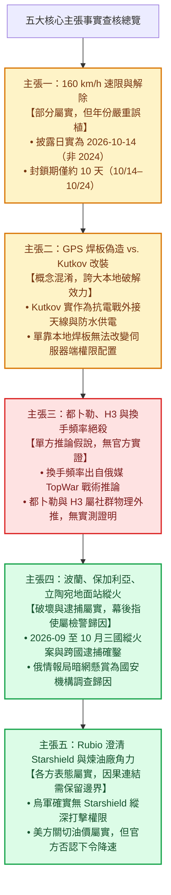
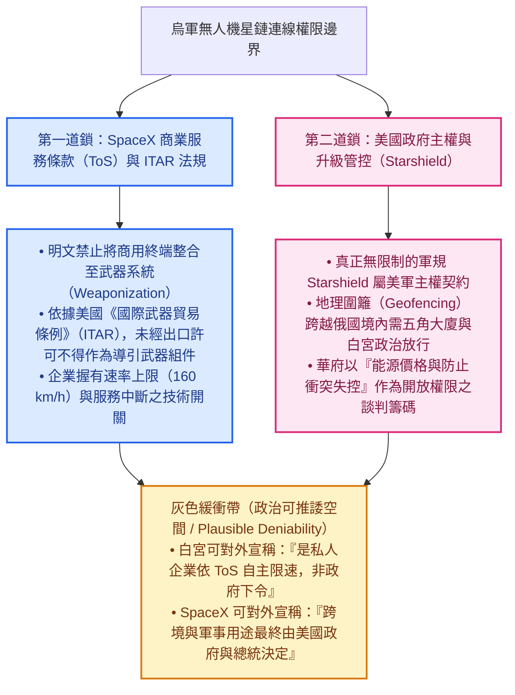

以下針對烏克蘭戰場星鏈（Starlink）技術爭端中的五大核心主張，結合公開情報（OSINT）、當事工程師第一手逆向文檔、主流外媒調查與專案既有文件（[starlink_ukraine_analysis.md](file:///Users/lanss/projects/2_Practice/readpaper/1151025_starlink/starlink_ukraine_analysis.md)、[guide.md](file:///Users/lanss/projects/2_Practice/readpaper/1151025_starlink/guide.md)、[source-ledger.md](file:///Users/lanss/projects/2_Practice/readpaper/1151025_starlink/research/source-ledger.md)），進行嚴格的事實查核與客觀性評估。

---

## 總體查核矩陣與因果結構

為方便在行動端直屏快速掃讀，以下將五大主張的「事實核心 vs. 誇大／誤植處」整理為直式架構圖：

---

## 主張一：100 mph（約 160 km/h）硬性移動速限與時間軸

> **原主張**：SpaceX 實施 100 mph（約 160 km/h）硬性移動速限，導致烏軍獵殺 Shahed 的攔截無人機（時速 180~300 km/h）斷訊。此事件是由 Serhii Flash 於 2024 年 10 月 14 日率先披露，並於 2026 年 10 月 24 日由澤倫斯基宣布解除。

### 1. 【查核結論】：部分屬實（技術現象與影響屬實，但「2024 年」為嚴重年份誤植，且獵殺目標應精確區分為噴射版／高速無人機與直升機防空網）
- **重大時間軸錯誤（年份誤植）**：Serhii Beskrestnov（呼號 "Serhii Flash"）與志願者 Serhii Sternenko 披露 SpaceX 無預警在夜間實施 100 mph（約 160–161 km/h）移動速限的真實日期是 **2026 年 10 月 14 日**，而非 2024 年 10 月 14 日。這場斷訊危機從爆發（2026-10-14）到烏克蘭總統澤倫斯基與國防部確認恢復 400+ km/h 連線（2026-10-24），**實際持續約 10 天**。專案內 [source-ledger.md](file:///Users/lanss/projects/2_Practice/readpaper/1151025_starlink/research/source-ledger.md#L20) 與 [guide.md](file:///Users/lanss/projects/2_Practice/readpaper/1151025_starlink/guide.md#L209) 將起始年份誤植為 2024 年，進而衍生出「一條在 2024 年被披露、在 2026 年才被解除的速限」之錯誤時間跨度敘事。
- **戰術影響核實**：160 km/h 速限確實導致高速載具斷訊，受衝擊最劇烈的是追擊俄軍高速無人機（包含時速達 300–400 km/h 的噴射動力版 Shahed-238 / Geran-3，以及常規螺旋槳版 Shahed-136）的**烏軍高速攔截型無人機**與**防空獵殺直升機編隊**。

### 2. 【證據強度等級】：一手官方與當事人指控（L1）＋ 權威外媒交叉印證（L2）
- **L1（一手當事人與官方）**：烏克蘭電戰顧問 Serhii Flash、Serhii Sternenko 於 2026 年 10 月 14 日之公開通報；烏克蘭總統澤倫斯基與國防部於 2026 年 10 月 24 日之官方聲明；Elon Musk 於 X（前 Twitter）上承認為封堵違反服務條款之「漏洞（loophole）」而實施暫時限制。
- **L2（權威外媒）**：《Kyiv Independent》、《Ukrainska Pravda》、Reuters 及《The Wall Street Journal》對 2026 年 10 月中下旬十日斷訊風波的完整追蹤報導。

### 3. 【技術可行性評估】
- **完全可行且屬星鏈標準流量管理機制**：SpaceX 在衛星網路管理與終端韌體中，本來就依據服務方案（Roam 移動方案、Maritime 海事、Aviation 航空）設定速度門檻。在軟體定義衛星網路（SDN）架構下，透過遠端更新參數將特定區域或特定合約群組的「移動中連線（In-Motion）速率上限」鎖定在 100 mph（160 km/h），在工程上僅需修改配置檔（Configuration Profile），可於數小時內全球或區域生效。

### 4. 【修正與文句建議】
- **修正方向**：立即修正 [source-ledger.md](file:///Users/lanss/projects/2_Practice/readpaper/1151025_starlink/research/source-ledger.md#L17-L23) 與 [guide.md](file:///Users/lanss/projects/2_Practice/readpaper/1151025_starlink/guide.md#L13-L34) 中的年份錯誤，刪除「長達兩年才解除」的推論，改為聚焦「十日閃電斷訊危機」。
- **建議改寫文句**：
  > 「2026 年 10 月 14 日，烏克蘭國防科技顧問 Serhii Beskrestnov（呼號 "Serhii Flash"）與多位前線人員披露，SpaceX 無預警對烏軍運作中的星鏈終端實施約 100 mph（約 160 km/h）的硬性移動速限。由於攔截俄軍 Shahed 系列無人機（特別是高速與噴射構型）的烏軍攔截機及防空直升機，巡航與追擊時速常落在 180 至 300 km/h 以上，該限制直接導致防空鏈路在追擊途中斷訊。經美烏高層緊急交涉後，澤倫斯基於 10 天後的 2026 年 10 月 24 日宣布速限解除，終端恢復 400 km/h 以上的高速連線能力。」

---

## 主張二：烏軍焊入「GPS 破解板」偽造靜止座標 vs. Oleg Kutkov 實際硬體改裝

> **原主張**：烏軍工程師拆解終端焊入「GPS 破解板」偽造靜止座標。這與 Oleg Kutkov 揭露的實際改裝（STA8089 晶片、陶瓷天線抗電戰燒毀焊跳線、外接抗干擾天線、防水 RJ45）有何差異？焊板能否單純騙過星鏈核心網？

### 1. 【查核結論】：概念遭混淆且誇大本地改裝效力（Kutkov 的改裝是「抗電戰求生」而非「作弊偽造」；單靠焊板無法騙過星鏈核心網）
- **Oleg Kutkov 真實改裝目的與細節**：基輔嵌入式與射頻工程師 Oleg Kutkov 自 2023 年底起公開的硬體逆向工程（包含 Gen2/Rev3 與後續機型拆解），是為了解決前線**三大物理與電戰生存痛點**，而非偽造座標：
  1. **抗 GPS 電戰干擾（外接天線改裝）**：星鏈主板內建 STMicroelectronics **STA8089** 系列 GNSS 接收晶片，搭配低增益（約 3 dB）的全向陶瓷貼片天線。在前線高強度俄軍電子戰（EW）干擾下，內建天線與前置低雜訊放大器（LNA）極易被蓋台甚至過載損毀，導致終端因失去 GPS 定位與精確時間同步（1PPS）而卡在無限開機迴圈（Boot loop）。Kutkov 的作法是移除或隔離內建陶瓷天線，在 50 歐姆射頻微帶線上焊上跳線與同軸母座，並透過偏置器（Bias Tee）外接高增益抗干擾主動式 GPS 天線。
  2. **野戰防水與供電改裝（防水 RJ45 與 DC 直供）**：原廠特規 SPX 接頭在戰場泥濘環境易進水，搭配約 48V 的 PoE 供電時常發生短路燒毀針腳；Kutkov 提出改裝標準 IP67/IP68 防水 RJ45 接頭與車載 12V/24V 直流升壓供電方案。
- **「GPS 破解板偽造靜止座標」與 Kutkov 實作的差異**：
  - Kutkov 證明了 STA8089 晶片與主處理器（SoC）之間透過標準 **UART 介面傳輸 NMEA 0183 格式字串**，這確實讓前線具備「切斷原廠 GNSS 晶片、改用微控制器（MCU）注入自訂 NMEA 靜態座標」的硬體可行性（俄媒與社群稱之為 GPS 欺騙板／エミュレータ）。
  - 然而，將這種改裝描述為「能全面騙過星鏈核心網、用 100 美元家用方案越級跑高速無人機」，則嚴重忽略了星鏈的系統架構限制。

### 2. 【證據強度等級】：一手工程逆向文檔（L1）vs. 俄方與社群戰術傳聞（L3）
- **L1（一手工程實證）**：Oleg Kutkov 個人技術部落格（`olegkutkov.me`）公開之電路板顯微照片、STA8089 腳位定義、NMEA 訊號分析與外接天線／RJ45 改裝指南。
- **L3（單方戰術傳聞）**：俄羅斯《軍事觀察》（TopWar）與部分 Telegram 頻道宣稱烏軍靠焊接自製 GPS 模擬板即可完美繞過地理圍籬與商用速限。

### 3. 【技術可行性評估】：本地 NMEA 注入可行，但「單純騙過核心網與物理層同步」不可行
1. **為何不能單純切斷 GPS 晶片？——1PPS 時脈同步硬約束**：
   星鏈終端的相位陣列天線（Phased Array）與衛星進行時分多工（TDMA）通訊時，極度依賴 GNSS 晶片提供的 **1PPS（One Pulse Per Second，每秒一脈衝）精確奈秒級授時訊號**。若只是焊上一塊廉價單晶片隨便吐出假 NMEA 文字座標，卻沒有提供與真實衛星同步的高精度 1PPS 時脈，終端連基本的時槽同步與波束追蹤都無法完成。此外，星鏈近年已透過韌體更新引入「利用星鏈自身低軌衛星訊號進行定位與授時」的備援機制（當外部 GPS 遭干擾時可切換使用），這代表終端內部本來就有第二套獨立於 STA8089 的位置感知來源。
2. **相位陣列波束成形（Beamforming）的物理矛盾**：
   終端天線必須根據「自身座標 + 內部慣性測量單元（IMU）姿態 + 衛星星曆（Ephemeris）」即時計算相控陣列的相位角，才能將窄波束對準天上的星鏈衛星。若終端透過 UART 被灌入「位於基輔靜止不動」的假座標，但無人機實際上已飛出數百公里外，當實際位置與偽造座標的幾何角度偏差超過波束寬度與韌體容錯範圍時，**終端本地的波束就會直接指錯方向而斷線**，根本不需要等到後端伺服器來抓。
3. **伺服器端權限配置（Server-Side Provisioning）**：
   誠如 Kutkov 逆向研究所指出，終端的服務等級、速率上限與白名單權限皆由 SpaceX 核心網伺服器端統一派發與控管，本地硬體改裝只能影響終端對自身座標的「自報值（Self-reported Telemetry）」，無法篡改核心網的授權狀態。

### 4. 【修正與文句建議】
- **修正方向**：[starlink_ukraine_analysis.md](file:///Users/lanss/projects/2_Practice/readpaper/1151025_starlink/starlink_ukraine_analysis.md#L45-L53) 將「焊接 GPS 破解板」直接當成既定事實且宣稱能「讓高速自殺無人機在俄羅斯領空維持即時影像傳輸」，應大幅收斂；[guide.md](file:///Users/lanss/projects/2_Practice/readpaper/1151025_starlink/guide.md#L73-L91) 雖已做出區分，但應補充 **1PPS 授時與相控陣列指向幾何** 的物理限制，解釋為何「假座標飛長程」在工程上會自取滅亡。
- **建議改寫文句**：
  > 「烏克蘭工程師 Oleg Kutkov 公開的星鏈硬體改裝（針對 STA8089 GNSS 晶片焊跳線外接主動式天線、改裝 IP67/IP68 防水 RJ45 與車載直流供電），核心目的是在俄軍高強度 GPS 電戰與惡劣野戰環境下『保住真實訊號與硬體存活』，而非偽造座標。雖然 STA8089 透過 UART 輸出 NMEA 座標的架構，在理論上允許接入微控制器覆寫座標以應付短距離的本地端檢查；但星鏈相控陣列天線極度依賴精確的 1PPS 時間同步與真實地理幾何來計算波束指向角。一旦偽造的靜態座標與實際飛行位置差距過大，終端波束便會因指向偏差而失鎖，且核心網的權限與流量控管均由伺服器端配置，單靠焊接本地破解板無法欺騙整個星鏈網路。」

---

## 主張三：伺服器端以「都卜勒頻移、H3 微蜂巢波束脫靶、衛星換手頻率超標」絕殺偽造座標

> **原主張**：SpaceX 伺服器端藉由「多普勒頻移矛盾、H3 微蜂巢波束脫靶、衛星換手（Handover）頻率超標」檢測偽造座標並中斷 Session。此說法在技術物理上是否站得住腳？目前是否有官方文件或實測證明，抑或僅為俄方評論的推論假說？

### 1. 【查核結論】：純屬單方推論假說與物理外推（無任何官方文件或獨立實測證明，且「換手頻率遠高於靜止」在物理尺度上被嚴重誇大）
- **來源拆解**：
  1. **「衛星換手（Handover）頻率超標即切斷 Session」**：直接出自 2026 年 10 月 25 日俄羅斯軍事媒體《軍事觀察》（TopWar，文章編號 `292301`）的評論文章〈Starlink на тормозах〉。**就連 TopWar 原文作者也在文中坦承，這套說法屬於沒有公開官方測試文件直接證實的「技術傳說／推論」**。
  2. **「都卜勒頻移矛盾」與「Uber H3 六角微蜂巢波束脫靶」**：這兩項則是把衛星通訊社群熟知的底層架構（星鏈確實使用 Uber H3 空間索引劃分地面服務網格 Cell，且 Ku 頻段訊號具備顯著都卜勒特性）與上述俄媒假說拼貼而成的**二次技術外推**。目前**完全沒有** SpaceX 官方文件、韌體逆向代碼或獨立實測數據證明 SpaceX 用這條規則來封殺烏軍無人機。

### 2. 【證據強度等級】：單方推論假說（L3）
- **L3（俄方評論與工程外推）**：俄媒 TopWar 戰術評論（自承無官方實證）＋ 專案內部先前的技術推演（[starlink_ukraine_analysis.md](file:///Users/lanss/projects/2_Practice/readpaper/1151025_starlink/starlink_ukraine_analysis.md#L54-L64)）。

### 3. 【技術可行性評估】：物理審查——哪些真能抓作弊？哪些其實是物理誤解？
我們用天體力學與無線電物理來嚴格檢驗這三個維度：

1. **維度一：衛星換手頻率（Handover Frequency）——【物理上被嚴重誇大，不適合作為 160 km/h 速限的主判準】**
   - **軌道速度 vs. 無人機速度的數量級懸殊**：低軌衛星（LEO）在約 550 公里軌道高度的運行速度高達 **$7.6 \text{ km/s}$（約 $27,360 \text{ km/h}$）**；而時速 $180 \text{ km/h}$ 的無人機，地面速度僅有 **$0.05 \text{ km/s}$**——兩者相差超過 **150 倍**！
   - **星鏈的 15 秒固定換手排程**：學術界對星鏈網路的實測研究（如對星鏈全網 Handover 週期之測量）早已證實，星鏈採用**每 15 秒一次的固定時槽排程（每分鐘的第 12、27、42、57 秒）**進行全網衛星與波束切換分配。
   - **因果推論**：因為衛星本身跑得比無人機快 150 倍，且系統強制每 15 秒固定換手一次，一架時速 $180 \text{ km/h}$ 的無人機在 15 秒內只移動了 **750 公尺**。除非受到地形遮蔽（如樹林、建築物阻擋視線 LoS 觸發被動重連，而在高空飛行的無人機反而完全無遮蔽！），否則高速無人機的「換手頻率」根本不會明顯高於地面靜止終端。俄媒宣稱「因為飛太快導致換手頻率暴增而被抓」，在軌道力學尺度上是外行人的直覺誤解。

2. **維度二：H3 蜂巢網格波束脫靶（H3 Cell / Spot Beam Mismatch）——【可抓「長程越界」，但抓不到「瞬間超速」】**
   - 星鏈使用 Uber H3（Level 5）六角形網格管理地面服務區，單一 Cell 直徑約 **22 至 24 公里**，衛星點波束（Spot Beam）地面投影直徑亦在數十公里等級。
   - 若無人機偽造座標留在原地，實際卻飛出二、三十公里外，確實會離開原本分配的 H3 Cell 波束覆蓋區而斷訊（脫靶）。但這只能限制「空間移動半徑（Geofencing）」，無法在無人機剛加速超過 $160 \text{ km/h}$ 的前幾分鐘內（尚未飛出同一個 22 公里網格時）即時判定「超速」。

3. **維度三：都卜勒頻移（Doppler Shift）與終端自報遙測——【物理上完全站得住腳，但最簡單的真相其實在終端韌體本身】**
   - **都卜勒頻移量級計算**：在 Ku 頻段（以下行約 $12 \text{ GHz}$、上行約 $14 \text{ GHz}$ 計），衛星本身運動造成的都卜勒頻移高達 $\pm 250 \text{ kHz}$ 以上；而一架以 $160 \text{ km/h}$（$44.4 \text{ m/s}$）移動的載具，在低仰角方向會額外產生約：
     $$\Delta f = \frac{v}{c} \cdot f_0 \approx \frac{44.4}{3 \times 10^8} \times 1.4 \times 10^{10} \approx 2,072 \text{ Hz} \ (\text{約 } 2 \text{ kHz})$$
     對於需要精確鎖相迴路（PLL）與載波同步的衛星數據機而言，$1\text{–}2 \text{ kHz}$ 的非預期頻率偏移殘差（Frequency Residual）是完全可測量的！因此從物理層「都卜勒頻移曲線殘差」抓出終端正在移動，在工程上絕對可行。
   - **奧卡姆剃刀（最直接的工程真相）**：事實上，絕大多數烏軍攔截無人機與防空直升機**根本沒有去焊什麼「偽造靜止座標破解板」**（因為焊假座標飛遠了波束就會失鎖）。它們使用的是正常開啟 GPS 與內部慣性元件（IMU）的終端，終端韌體本來就會透過 gRPC/遙測通道忠實測量並執行 SpaceX 下發的 `100 mph` 速率限制策略！當馬斯克說「堵住漏洞」時，指的是把原本未設限或被挪用的服務方案加上 160 km/h 軟體速限，根本不需要動用「伺服器端統計換手頻率」這種曲折的傳奇演算法。

### 4. 【修正與文句建議】
- **修正方向**：[starlink_ukraine_analysis.md](file:///Users/lanss/projects/2_Practice/readpaper/1151025_starlink/starlink_ukraine_analysis.md#L58-L63) 將「換手頻率 > 臨界值 → 中斷 Session」寫成既定事實公式，必須撤除或改列為俄媒假說；[guide.md](file:///Users/lanss/projects/2_Practice/readpaper/1151025_starlink/guide.md#L114-L167) 雖已標註為「推論分析／單方主張」，建議進一步加入上述軌道速度對比（$27,000 \text{ km/h}$ vs. $180 \text{ km/h}$）與 15 秒固定換手週期的工程批判，展現真正的硬核查核深度。
- **建議改寫文句**：
  > 「關於 SpaceX 透過『衛星換手（Handover）頻率超標、都卜勒頻移矛盾與 H3 波束脫靶』在伺服器端封殺偽造座標的說法，目前並無任何 SpaceX 官方文件或逆向實測證實，其核心論述源自俄媒《軍事觀察》（TopWar）於 2026 年 10 月 25 日發表的推論（該文亦自承無官方文件佐證）。從物理與通訊工程角度檢視：低軌衛星時速高達 27,000 km/h 且星鏈採每 15 秒固定排程換手，時速 180 km/h 的無人機在 15 秒內僅位移 750 公尺，不會單因空速而導致『換手頻率暴增』；反倒是 Ku 頻段約 2 kHz 的額外都卜勒頻移殘差，以及飛出 22 公里 H3 網格後的波束脫靶，才是物理上真正無法欺騙的鐵律。更關鍵的是，多數前線防空載具並未改裝假座標，而是直接受制於星鏈常規的速率限制策略。」

---

## 主張四：2026 年 9 至 10 月波蘭、保加利亞與立陶宛星鏈設施遭混合戰縱火

> **原主張**：2026 年 9 至 10 月間，波蘭 Wola Krobowska 地面站、保加利亞與立陶宛通訊設施遭親俄分子依 Telegram/暗網接單縱火，此混合戰破壞事件的確鑿程度如何？

### 1. 【查核結論】：高度確鑿（實體縱火、設施損毀、跨國逮捕與各國國安機構定性皆有第一手官方通報；惟「Telegram/暗網懸賞金額細節」與「俄情報局直接下令」屬檢警偵查歸因階段）
- **三起事件逐一核實**：
  1. **波蘭 Wola Krobowska 地面站（2026 年 9 月 23 日）**：**確鑿**。位於華沙以南約 40 公里、由波蘭國營電信商 Exatel 營運的星鏈地面站（Gateway，負責中東歐與烏克蘭流量路由）於 9 月 23 日夜間遭縱火，損毀配電單元、備用發電機與天線設施。波蘭國家檢察署與內部安全局（ABW）以恐怖主義與蓄意破壞立案，並於 10 月中旬在德國警方協助下逮捕多名涉案嫌犯（包含土耳其裔人士）。
  2. **保加利亞索非亞近郊／普拉納（Plana）地面站（2026 年 10 月 9–10 日）**：**確鑿**。兩名蒙面入侵者闖入索非亞近郊受保護的衛星通訊地面站，縱火焚毀 **17 座星鏈閘道器天線中的 11 座**。保加利亞官方證實展開跨國調查，鎖定兩名持德國護照潛逃出境的年輕嫌犯並申請歐洲逮捕令（EAW）。
  3. **立陶宛維爾紐斯（Vilnius）星鏈基站／倉儲（2026 年 10 月 18 日）**：**確鑿**。位於維爾紐斯郊區（Aukštieji Paneriai）的星鏈設施遭人攜帶汽油彈與 3–10 公升易燃液體縱火，目標針對衛星天線與控制單元；因當局事前預警、保全及時撲滅，僅造成輕微燒損。立陶宛總理與國家危機管理中心（NKVC）公開定性為針對援烏基礎設施的混合戰破壞。
- **招募模式與幕後歸因**：歐洲安全官員與媒體調查指出，俄方情報單位（如 GRU）透過 Telegram 與暗網以加密貨幣招募外籍移工、邊緣青年或微罪分子（「拋棄式特工」零工經濟模式）執行縱火。此模式符合近年歐洲多起俄羅斯混合戰破案特徵，但個別案件的具體懸賞金額與最終司法定罪仍在偵審程序中。

### 2. 【證據強度等級】：一手官方檢警通報（L1）＋ 多國權威媒體交叉印證（L2）
- **L1（官方檢警與政府首長）**：波蘭內部安全局（ABW）與內政部、保加利亞政府與檢方、立陶宛總理 Mindaugas Sinkevičius 與國家危機管理中心（NKVC）之公開聲明。
- **L2（主流外媒）**：美聯社（AP）、TVP World、The Sofia Globe、Kyiv Independent、PCMag 等多家媒體之具名報導。

### 3. 【技術可行性評估】：星鏈架構中「地面段（Ground Segment）」的實體脆弱性
- **為何燒地面站有效？**：儘管星鏈二代衛星具備星間雷射鏈路（ISL, Inter-Satellite Links），可將數據在太空中接力傳遞至更遠的地面站，但區域內的**高頻寬低延遲落地出口（Gateway / PoP）**仍高度仰賴鄰近國家（如波蘭、保加利亞、立陶宛）的地面閘道器。
- 地面閘道器天線罩（Radome）與外部電力變壓器通常位於偏遠開闊地帶以確保仰角無遮蔽，且屬民用電信設施而非軍事基地，實體戒備相對薄弱。以數千美元成本派人翻牆潑汽油燒毀天線與配電盤，是極高性價比的非對稱混合戰攻擊面（Attack Surface）。

### 4. 【修正與文句建議】
- **修正方向**：[guide.md](file:///Users/lanss/projects/2_Practice/readpaper/1151025_starlink/guide.md#L175-L187) 對本主張的處理已相當審慎（明確區分「已通報事實」與「檢警歸因」），僅需微調保加利亞事件的日期標示（部分外媒記載為 10 月 9 日夜間至 10 月 10 日凌晨，並補充「17 座天線中焚毀 11 座」與「德國逮捕嫌犯」之具體細節以強化證據厚度）。
- **建議改寫文句**：
  > 「2026 年 9 月下旬至 10 月中旬，支援烏克蘭連線的歐洲星鏈地面基礎設施接連遭遇實體縱火：9 月 23 日波蘭 Wola Krobowska 地面站配電與天線受損（德國警方隨後於 10 月中旬協助逮捕涉案嫌犯）；10 月 9 日至 10 日間，保加利亞索非亞近郊地面站遭闖入，17 座星鏈閘道天線中有 11 座被焚毀；10 月 18 日立陶宛維爾紐斯郊區設施亦遭汽油彈攻擊未遂。波蘭內部安全局（ABW）與立陶宛國家危機管理中心均公開將此定性為俄羅斯情報部門主導的混合戰破壞。至於透過 Telegram 與暗網以加密貨幣懸賞外包犯案的細節，目前屬於歐洲國安機構與外媒的偵查歸因，尚待最終司法審判確認。」

---

## 主張五：Marco Rubio 澄清烏軍無 Starshield 權限、美方拒絕縱深打擊與 WSJ 煉油廠報導

> **原主張**：美國國務卿 Marco Rubio 澄清烏軍「未擁有 Starshield 軍用權限」，美方拒絕烏方以 Starshield 縱深打擊俄本土；華爾街日報報導美方關切烏軍打擊俄煉油廠。美方政策與商業服務條款（ToS）的界限何在？

### 1. 【查核結論】：完全屬實（官方公開談話與主流外媒具名調查皆確鑿，惟需精確爬梳「五角大廈採購之商用星鏈／Starshield 合約」與「美軍專屬 Starshield 縱深打擊權限」的語意落差）
- **Marco Rubio 談話核實**：2026 年 10 月中下旬，針對星鏈限速引發的政治風暴，美國國務卿 Marco Rubio 公開做出三點核心澄清：
  1. **區分 Starlink 與 Starshield**：Starlink 是商用網路，而 Starshield 是專屬於美國國防部與國安機構的軍規產品。
  2. **烏軍未獲 Starshield（無限制／縱深打擊）授權**：Rubio 明確指出烏克蘭目前並未擁有美軍等級的 Starshield 完整權限；烏方雖曾正式向美方申請使用 Starshield 以支援對俄羅斯境內的縱深打擊（Deep Strikes），但美方並未批准。
  3. **否認白宮下令降速**：Rubio 斷言川普總統與白宮無人下令調降星鏈速度，將 160 km/h 速限歸因於 SpaceX 作為私人企業依其商業服務條款（ToS）與技術自主所做的決定。
- **為什麼烏方官員（如 Serhii Flash）會說「Starshield 被限速」，而 Rubio 卻說「烏克蘭沒有 Starshield」？（關鍵語意解構）**：
  - 這裡存在一個極重要的合約層級差異：五角大廈先前出資為烏軍採購的高優先級星鏈服務方案，在前線與媒體口中常被泛稱為「Starshield 軍用套件（military package）」；但在美國國務院與太空軍的嚴格定義中，真正的 **Starshield 軍規系統**受美國政府（DoD/NRO）主權控制，不受民用 ToS 限制。烏軍實際上使用的是「由美國防部買單或白名單列管的商業版／加固版 Starlink 終端」，因此當逾越地理圍籬或速度門檻時，仍會觸發 SpaceX 的商業風控機制。
- **《華爾街日報》（WSJ）煉油廠之爭核實**：WSJ 於 2026 年 10 月調查披露，川普政府與馬斯克對烏軍持續以長程無人機打擊俄羅斯煉油廠與柴油設施、進而推升全球能源價格感到強烈不滿；此前美國聯邦參議員（Roger Wicker 與 Kevin Cramer）訪烏時甚至曾提出「烏軍暫停攻擊俄國煉油廠 100 天，換取美方擴大星鏈在俄境內覆蓋範圍以打擊飛彈發射車」的交易提案。WSJ 引述知情官員指稱，馬斯克在實施 10 月中旬的速限前後，曾與川普政府官員討論此事。

### 2. 【證據強度等級】：一手官方公開談話（L1）＋ 權威外媒深度調查（L2）
- **L1（官方談話）**：美國國務卿 Marco Rubio 公開記者會談話（美國國務院紀錄）、烏克蘭總統澤倫斯基公開發言、Elon Musk 於 X 之貼文。
- **L2（權威外媒具名調查）**：《The Wall Street Journal》與 Reuters 於 2026 年 10 月中下旬針對白宮、五角大廈、國會參議員提案與 SpaceX 決策鏈之深度調查報導。

### 3. 【技術與法規可行性評估】：美國政府政策 vs. SpaceX 商業服務條款（ToS）的真實界限
這場爭端揭示了現代「商業科技軍事化（COTS Militarization）」最核心的治理雙重邊界：

1. **商業服務條款（ToS）與 ITAR 出口管制的法律邊界**：
   SpaceX 的商用服務條款明文規定，星鏈服務「並非設計或授權用於進攻性或防禦性武器系統」，且依據美國《國際武器貿易條例》（ITAR）與《出口管理條例》（EAR），若商用衛星通訊終端被直接嵌入自殺式無人機作為遠程打擊導引鏈路，將從「商用通訊設備」質變為「受管制的軍火組件」。這賦予了 SpaceX 隨時以「合規與防堵漏洞」為由，在技術端鎖定 160 km/h 速限的合法正當性。
2. **國家政策與「可推諉空間（Plausible Deniability）」的政治邊界**：
   當烏克蘭申請不受 ToS 限制的軍規 **Starshield** 權限時，決定權就完全移交到白宮與五角大廈手中。而當烏軍維持使用「商用星鏈」時，美方政府與 SpaceX 之間便形成了一個極具彈性的**政治緩衝帶**：華府關切烏軍打擊俄國煉油廠衝擊油價時，無須由總統簽署具政治爭議的正式禁令，只需由 SpaceX 以「執行商業 ToS、關閉超速漏洞」名義拉下 160 km/h 閘門；事後國務卿 Rubio 可在法律上完全站得住腳地聲明「白宮沒有下令降速」，而馬斯克也能同時在 X 上表示「是否開放軍事限制取決於美國政府」，直到美烏完成政治折衝後再於 10 月 24 日「恢復 400 km/h 連線」。

### 4. 【修正與文句建議】
- **修正方向**：[guide.md](file:///Users/lanss/projects/2_Practice/readpaper/1151025_starlink/guide.md#L189-L212) 已能平衡呈現 Rubio 的否認與 WSJ 的調查，建議補充**「前線泛稱的 Starshield 套件 vs. 國務院定義的美軍主權 Starshield」之語意釐清**，並點出「商業 ToS 與政府政策互為掩護的可推諉機制（Plausible Deniability）」。
- **建議改寫文句**：
  > 「美國國務卿 Marco Rubio 於 2026 年 10 月中下旬公開澄清，烏軍目前使用的是商業版星鏈，並未獲授美軍專屬的『星盾（Starshield）』完整權限；烏方雖曾申請以 Starshield 執行對俄縱深打擊，但未獲美方放行（至於烏方前線常提及的 Starshield，實指五角大廈出資採購之特定星鏈商用／白名單套件，仍受制於服務限制）。針對《華爾街日報》（WSJ）披露川普政府與馬斯克因不滿烏軍襲擊俄國煉油廠推升油價、進而引發馬斯克下令限速的調查報導，Rubio 則明確否認白宮曾下令降速，強調這是 SpaceX 依據商業服務條款（ToS）的自主行為。這凸顯了 COTS 民用科技在戰場上的治理邊界：商業 ToS（禁止武器化）與美國政府政策（管控跨境升級與能源衝擊）形成了一道雙重鎖，既讓企業握有改變戰術邊界的技術開關，也為政府與企業之間提供了『可推諉（Plausible Deniability）』的政治操作空間。」

---

## 總結：針對專案文稿的後續行動建議

1. **優先修補 P0 級事實錯誤**：將 [source-ledger.md](file:///Users/lanss/projects/2_Practice/readpaper/1151025_starlink/research/source-ledger.md#L20) 與 [guide.md](file:///Users/lanss/projects/2_Practice/readpaper/1151025_starlink/guide.md#L13-L34) 中 Serhii Flash 披露速限的年份由 `2024 年 10 月 14 日` 更正為 **`2026 年 10 月 14 日`**，並改寫所有提及「速限持續兩年」的段落。
2. **強化物理層與硬體層的精確度**：在第二、三章補入 **1PPS 授時限制、相控陣列指向幾何**，以及 **LEO 軌道速度（27,000 km/h）與 15 秒固定換手週期** 對俄媒 TopWar「換手頻率超標論」的工程反駁。

如需我根據以上查核結論，直接為您更新專案中的 [source-ledger.md](file:///Users/lanss/projects/2_Practice/readpaper/1151025_starlink/research/source-ledger.md)、[guide.md](file:///Users/lanss/projects/2_Practice/readpaper/1151025_starlink/guide.md) 或輸出查核報告至指定檔案，請告訴我，確認範圍後我再動手修改！
