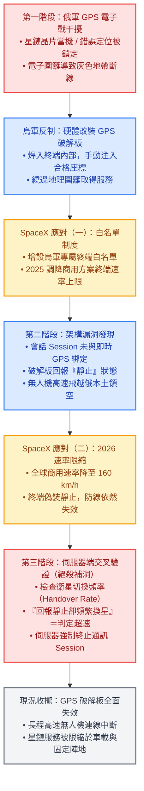

# 烏克蘭星鏈（Starlink）技術攻防與限制演進解析

> 本文梳理烏克蘭戰場上圍繞 SpaceX 星鏈（Starlink）的技術對抗歷程：從俄軍 GPS 電子干擾、烏軍焊入 GPS 破解板偽造靜止狀態以突破電子圍籬與速率限制，到 SpaceX 引入伺服器端衛星換手（Handover）行為交叉分析徹底封閉漏洞之完整因果鏈。

---

## 專有名詞速查字典

- **電子圍籬（Geofencing）**：系統根據座標判定裝置是否在合法服務區內。未獲授權的區域（如俄控區或灰色地帶）將被阻斷連線。
- **Session（通訊會話）**：終端與衛星建立的通訊通道。此漏洞在於早期「會話認證僅依賴終端回報的座標與狀態，後端伺服器並未做物理軌跡交叉驗證」。
- **Satellite Handover（衛星換手／切換）**：低軌衛星（LEO）以約 27,000 km/h 高速繞行地球，單一衛星過境視野通常僅數分鐘。終端在連線時需持續在不同衛星間切換。若終端本身高速位移，切換頻率與角度變化將出現異常特徵。
- **星盾（Starshield）**：SpaceX 專為美國國防與國安機構打造的軍用版低軌衛星網路，支援軍規加密與高動態作戰需求。

---

## 一、 技術攻防因果演進鏈

烏軍無人機與 SpaceX 平台限制之間，經歷了三輪關鍵的攻防對抗與修補：

---

## 二、 核心技術細節深入剖析

### 1. 為何「GPS 破解板」初期能成功欺騙系統？

* **客戶端信任漏洞（Client-Side Trust）**：
  早期星鏈協議設計上，假設「終端模組所回報的 GPS 資訊是真實且受信的」。驗證邏輯大量落在終端本體模組上，衛星端與後端伺服器未進行多重實體層驗證。
* **靜止偽裝機制**：
  烏軍技術人員在送往前線前，拆開民用星鏈終端外殼，將自製 GPS 破解板焊接至主板，攔截原始 GPS 訊號並覆寫為合規的靜態座標。
* **低成本越級打怪**：
  終端向衛星請求認證時，自稱「完全靜止於地面」，成功繞過商用移動或航空等級的限制，以每月 100 美元的基本費率，讓高速自殺無人機在俄羅斯領空維持即時影像傳輸與遙控。

### 2. SpaceX 如何利用「伺服器端檢查」徹底絕殺？

* **物理特徵無法偽造**：
  終端雖然可以在軟體與硬體層面偽造「我不動」，但無法違背電波傳遞與天體力學物理特徵。
* **衛星換手（Handover）行為模型分析**：
  地面固定陣地的終端，切換低軌衛星的時間間隔與幾何軌跡呈現規律分佈。當無人機以順風超過 160 km/h 的速度巡航時，與軌道衛星的相對運動速度疊加，導致**終端在不同星鏈衛星波束之間的切換頻率（Handover Frequency）遠高於靜止或低速車輛**。
* **後端風控規則升級**：
  SpaceX 於伺服器端部署比對演算法：
  $$\text{終端回報} = \text{靜止} \quad \land \quad \text{衛星切換速率} > \text{臨界值} \implies \text{立即中斷 Session}$$
  此舉跳過了終端本地驗證，從衛星網路調度層直接辨識出實體位移，使偽裝座標徹底失效。

---

## 三、 戰略、政治與未來侷限

1. **民用與攻擊武器的邊界收攏**：
   - 商業版星鏈本質屬於民用與通訊基礎設施，SpaceX 使用條款明確禁止將其作為自主武器與長程打擊導引系統。
   - 航空級方案（Aviation，每月數千至數萬美元）在烏克蘭及周邊禁售，阻斷了高價合規採購的途徑。
2. **星盾（Starshield）政治拉鋸**：
   - 烏克蘭政府積極爭取取得美軍版「星盾」終端與無限制使用權，試圖突破 160 km/h 與領空限制。
   - 美方考量地緣政治升級風險，五角大廈與馬斯克均未開放此項授權。
3. **戰術妥協與現狀**：
   - 衛星通訊在高速無人機上本屬權宜之計（訊號往返軌道約產生數百公里等效延遲）。
   - 隨著伺服器端補丁落地，星鏈在烏軍的角色重新被定錨於「地面陣地作戰、車載指揮與防禦性後勤通訊」，無人機遠程打擊則被迫重回慣性導航、光纖線控或自研抗干擾電台技術。
